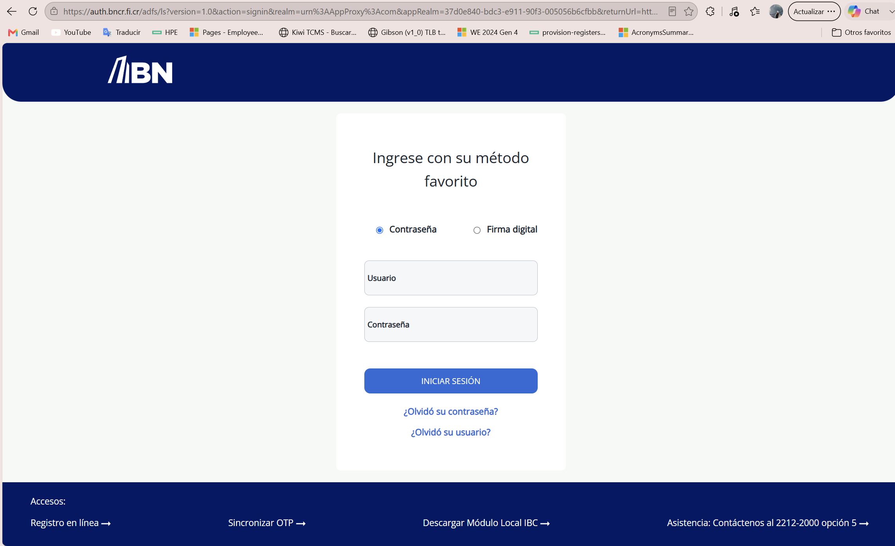
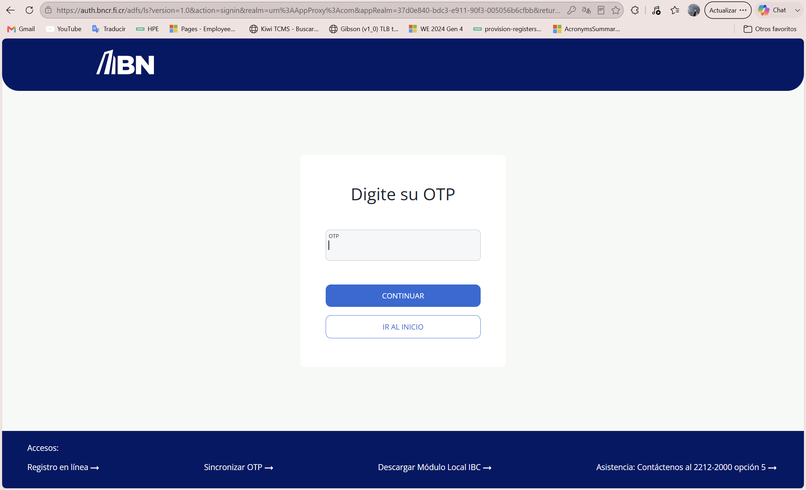
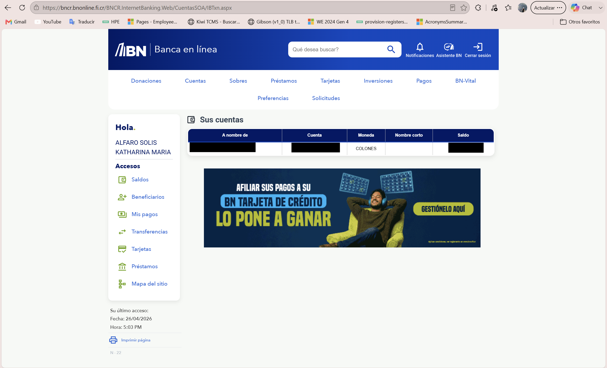

# Tarea # 1: Definición del sistema a probar
## Estudiante: Katharina Alfaro Solís

Para esta tarea se seleccionó una aplicación web con la siguiente información.

- Nombre del sistema: Banco Nacional de Costa Rica
- Dirección web: https://www.bncr.fi.cr/
- Logo: 

### Propósito del sistema
- ¿Qué problema resuelve?

Resuelve varios problemas, entre ellos no tener que ir al banco presencialmente y ahorrar tiempo con ello. Facilitar ciertos procesos, como la creación de cuentas favoritas, la transferencia de dinero de una cuenta a otra, entre otros procesos bancarios...

- ¿Cuál es su público objetivo?

Ciudadanos costarricenses principalmente con la necesidad de tener cuenta bancaria.

- ¿Cuál es el flujo de uso esperado más común?

Entrar a banca en línea, revisar el monto en la cuenta y realizar alguna transferencia. El flujo se vería de la siguiente forma:

Se selecciona el botón banca en línea y abrimos la página de log in:

Luego de ingresar nuestro usuario y contraseña, nos pide otra verificación.

Luego de esto ya entramos a la página de Banca en línea, que se ve de la siguiente manera:

Desde acá podemos hacer varias cosas, pero los flujos principales son los que podemos ver como accesos en la columna a la izquierda como lo son Saldos, Beneficiarios, Mis Pagos, Transferencias, Tarjetas, Préstamos y Mapa del Sitio.