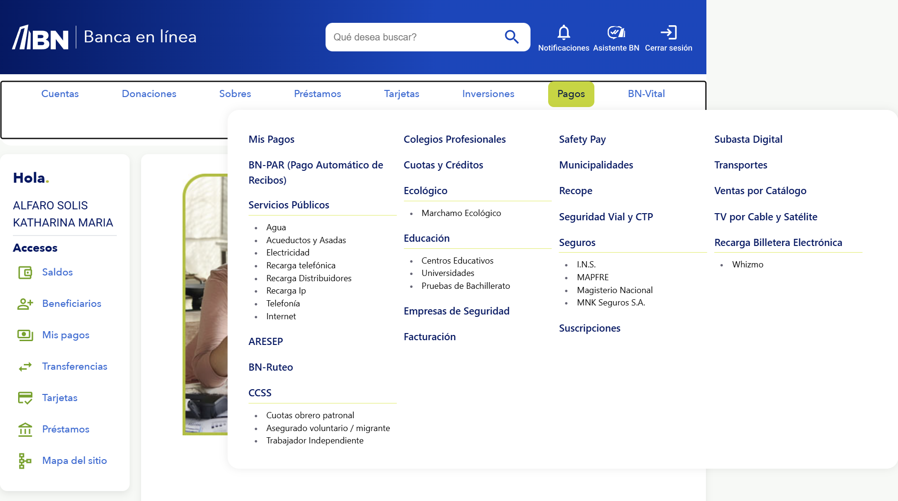

# Caso de Prueba 1: Poder realizar un pago a un servicio público

## ID

CT-012

## Objetivo

Verificar que se pueda llenar los datos para hacer un pago de un servicio público como la electricidad.

## Precondiciones

- Haber iniciado sesión a Banca en línea
- Tener una cuenta bancaria activa
- Tener un recibo de luz que pagar

## Datos de Entrada

- Cuenta a debitar
- Provedor del servicio

## Pasos

1. Acceder a la página de Banca en Línea.
2. Ingresar el nombre de usuario y la contraseña en el formulario.
3. Hacer clic en el botón "Iniciar sesión".
4. Digitar el código OTP solicitado como segunda verificación.
5. Presionar el botón "Continuar".
6. Seleccionar el botón "Pagos" de la barra superior.
7. En la sección Pagos, el tipo de pago que sería Servicio Público.

## Resultado Esperado

- Poder seleccionar correctamente el servicio a pagar.
- Tener un pago exitoso (en caso de que exista el cobro).

## Resultado Obtenido

- Se pudo llegar hasta el servicio para hacer el pago, pero no habían cobros.

## Estado de la prueba

⚠️ Dudoso (Porque no se completó ningun pago)

## Observaciones

- Al seleccionar un servicio público sale otra página donde se despliegan los diferentes provedores del servicio.

# Caso de Prueba 2: Revisar flujo para pagar Universidad

## ID

CT-0013

## Objetivo

Verificar que se pueda llenar los datos para hacer un pago de la universidad.

## Precondiciones

- Haber iniciado sesión a Banca en línea
- Tener una cuenta bancaria activa

## Datos de Entrada

- Universidad
- Carne o identificacion
- Cuenta debidar

## Pasos

1. Acceder a la página de Banca en Línea.
2. Ingresar el nombre de usuario y la contraseña en el formulario.
3. Hacer clic en el botón "Iniciar sesión".
4. Digitar el código OTP solicitado como segunda verificación.
5. Presionar el botón "Continuar".
6. Seleccionar el botón "Pagos" de la barra superior.
7. En la sección Pagos, el tipo de pago que sería Eduación Universidades.

## Resultado Esperado

- Poder ver el cobro de la universidad al digitar el carné del estudiante.

## Resultado Obtenido

- Se obtuvo el resultado esperado, se pudo ver el cobro de la universidad en este caso de la Universidad de Costa Rica.

## Estado de la prueba

✅ Pasó

## Observaciones

- No hay.

# Caso de Prueba 3: Poder realizar pago de Seguros como el INS o de la CCSS

## ID

CT-014/CT-015

## Objetivo

Verificar que se pueda llenar los datos para hacer un pago del INS en realidad cualquier otro tipo de pago, los pasos son los mismos que en las pruebas pasadas.

## Precondiciones

- Haber iniciado sesión a Banca en línea
- Tener una cuenta bancaria activa

## Datos de Entrada

- Datos dependiendo del tipo de pago
- INS: Tipo de seguro e identificador

## Pasos

1. Acceder a la página de Banca en Línea.
2. Ingresar el nombre de usuario y la contraseña en el formulario.
3. Hacer clic en el botón "Iniciar sesión".
4. Digitar el código OTP solicitado como segunda verificación.
5. Presionar el botón "Continuar".
6. Seleccionar el botón "Pagos" de la barra superior.
7. En la sección Pagos, el tipo de pago que en este caso sería Seguros INS.

## Resultado Esperado

- Poder intentar accesar a un cobro del seguro del INS de haber uno. En este caso se espera que no haya cobro por pago previo.

## Resultado Obtenido

- No había ningún cobro que es esperado.

## Estado de la prueba

✅ Pasó

## Observaciones

- No hay.