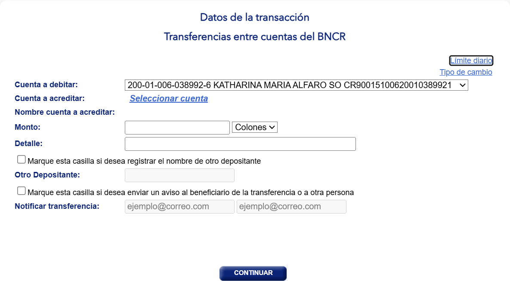
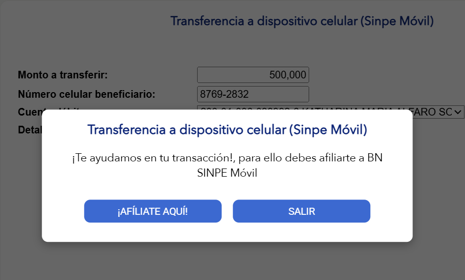

# Caso de Prueba 1: Poder realizar transferencia entre cuentas del Banco Nacional

## ID

CT-008

## Objetivo

Verificar que se pueda llenar el formulario para hacer una transferencia entre cuentas del Banco Nacional.

## Precondiciones

- Haber iniciado sesión a Banca en línea
- Tener una cuenta bancaria activa
- Tener una cuenta favorita creada para enviar la tranferencia

## Datos de Entrada

- Cuenta a debitar
- Cuenta a acreditar
- Nombre cuenta a acreditar
- Monto
- Detalle

## Pasos

1. Acceder a la página de Banca en Línea.
2. Ingresar el nombre de usuario y la contraseña en el formulario.
3. Hacer clic en el botón "Iniciar sesión".
4. Digitar el código OTP solicitado como segunda verificación.
5. Presionar el botón "Continuar".
6. Seleccionar el botón "Cuentas" de la barra superior.
7. En la sección Transferencias, seleccionar la opción cuentas de BNCR.

## Resultado Esperado

- Poder seleccionar correctamente las cuentas
- Digitar el monto de la transacción
- Tener una transacción exitosa.

## Resultado Obtenido

- Se obtuvo el resultado esperado sin errores en el sistema. La transacción se pudo realizar.

## Estado de la prueba

✅ Pasó

## Observaciones

- Se observa que en el formulario una opción para anotar el nombre de otro depositante, también el correo electrónico.
- También sale la opción para ver el limite configurado para transferencias y el tipo de cambio por si la transacción es en otra moneda.
- Solo se puede hacer una transferencia a una cuenta favorita previamente creada.

# Caso de Prueba 2: Realizar transferencia SINPE Movil

## ID

CT-009

## Objetivo

Verificar que no se pueda realizar transferencia si no se tiene SINPE movil configurado

## Precondiciones

- Haber iniciado sesión a Banca en línea
- Tener una cuenta bancaria activa

## Datos de Entrada

- Número de teléfono
- Monto a transferir
- Cuenta de debito
- Detalle

## Pasos

1. Acceder a la página de Banca en Línea.
2. Ingresar el nombre de usuario y la contraseña en el formulario.
3. Hacer clic en el botón "Iniciar sesión".
4. Digitar el código OTP solicitado como segunda verificación.
5. Presionar el botón "Continuar".
6. Seleccionar el botón "Cuentas" de la barra superior.
7. En la sección Transferencias, seleccionar la opción SINPE Movil.

## Resultado Esperado

- Al intentar hacer la transferencia por medio de SINPE movil tener un mensaje denegado por no tener el SINPE movil configurado en el Banco Nacional.

## Resultado Obtenido

- Se obtuvo el resultado esperado, se obtuvo un mensaje de error (Ver imagen)

## Estado de la prueba

✅ Pasó

## Observaciones

- No hay.

# Caso de Prueba 3: Poder realizar transferencia entre cuentas de Otros Bancos

## ID

CT-010

## Objetivo

Verificar que se pueda llenar el formulario para hacer una transferencia entre cuentas de otros bancos.

## Precondiciones

- Haber iniciado sesión a Banca en línea
- Tener una cuenta bancaria activa
- Tener una cuenta favorita creada para enviar la tranferencia

## Datos de Entrada

- Cuenta a debitar
- Cuenta a acreditar
- Datos del beneficiario
- Numero de cédula
- Nombre del cliente
- Monto a Tranferir
- Concepto

## Pasos

1. Acceder a la página de Banca en Línea.
2. Ingresar el nombre de usuario y la contraseña en el formulario.
3. Hacer clic en el botón "Iniciar sesión".
4. Digitar el código OTP solicitado como segunda verificación.
5. Presionar el botón "Continuar".
6. Seleccionar el botón "Cuentas" de la barra superior.
7. En la sección Transferencias, seleccionar la opción Hacia Otros Bancos.
8. En la nueva página (imagen adjunta) seleccionar Realizar Transferencia.

## Resultado Esperado

- Poder seleccionar correctamente las cuentas
- Digitar el monto de la transacción
- Tener una transacción exitosa.

## Resultado Obtenido

- Se obtuvo el resultado esperado sin errores en el sistema.
- El formulario se puede llenar correctamente.

## Estado de la prueba

✅ Pasó

## Observaciones

- Solo se puede hacer una transferencia a una cuenta favorita previamente creada.
- La página intermedia (imagen adjunta) podría aprovecharse mejor y evitar un paso extra.

# Caso de Prueba 4: Transferencia Desde otros bancos

## ID

CT-011

## Objetivo

Verificar que se pueda llenar el formulario para hacer una transferencia desde otros bancos.

## Precondiciones

- Haber iniciado sesión a Banca en línea
- Tener una cuenta bancaria activa

## Datos de Entrada

- Cuenta a debitar (Cuenta de otro banco que debe estar como favorita)
- Cuenta a acreditar
- Monto a Tranferir
- Concepto
- Correo electrónico

## Pasos

1. Acceder a la página de Banca en Línea.
2. Ingresar el nombre de usuario y la contraseña en el formulario.
3. Hacer clic en el botón "Iniciar sesión".
4. Digitar el código OTP solicitado como segunda verificación.
5. Presionar el botón "Continuar".
6. Seleccionar el botón "Cuentas" de la barra superior.
7. En la sección Transferencias, seleccionar la opción Desde Otros Bancos.
8. LLenar formulario para hacer la transferencia.

## Resultado Esperado

- Poder seleccionar correctamente las cuentas
- Digitar el monto de la transacción
- Tener una transacción exitosa.

## Resultado Obtenido

- Se obtuvo el resultado esperado sin errores en el sistema.
- El formulario se puede llenar correctamente.

## Estado de la prueba

✅ Pasó

## Observaciones

- Solo se puede hacer una transferencia si la cuenta es una cuenta favorita previamente creada.