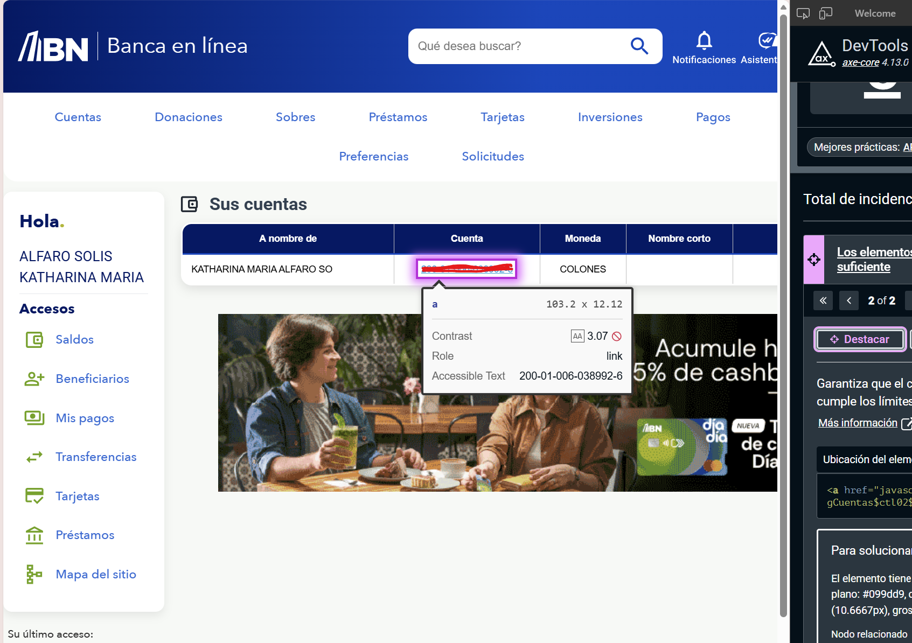

# 🐞 Reporte de Bug

## ID

BUG-001

## Título

Contraste insuficiente en el enlace del número de cuenta de la tabla de cuentas.

## Estado

- Nuevo

## Reportado por

Katharina Alfaro Solís

## Fecha de detección

2026-10-23

## Prioridad

- 🟠 Alta
Afecta la legibilidad de información financiera para personas con baja visión.

## Descripción

El enlace que muestra el número de cuenta presenta contraste insuficiente entre el texto azul (#099dd9) y el fondo blanco (#ffffff).

La herramienta axe reporta una relación de contraste de 3.07:1, inferior al mínimo de 4.5:1 requerido para texto de tamaño normal por el criterio 1.4.3 Contraste (mínimo), nivel AA de WCAG 2.0, también aplicable en WCAG 2.1 y 2.2.

El texto tiene un tamaño de 8 pt (aproximadamente 10.67 px) y un grosor normal; por tanto, no corresponde a texto grande y no aplica el umbral reducido de 3:1.

Esta condición puede dificultar la identificación y lectura del número de cuenta para personas con baja visión o sensibilidad reducida al contraste.

## Pasos para reproducir

1. Iniciar sesión con un usuario de pruebas autorizado que tenga cuentas disponibles.
2. Acceder a la página indicada en el entorno de pruebas.
3. Localizar la tabla que contiene los enlaces de números de cuenta.
4. Ejecutar un análisis de accesibilidad con axe.

## Resultado esperado

-El enlace del número de cuenta debe presentar una relación de contraste de al menos 4.5:1 entre el texto y su fondo efectivo, manteniendo su legibilidad y funcionamiento.

## Resultado obtenido

Axe identifica contraste insuficiente con la siguiente información:

Color del texto	#099dd9
Color de fondo	#ffffff
Tamaño de fuente	8 pt / 10.6667 px
Grosor de fuente	Normal
Relación de contraste obtenida	3.07:1
Relación mínima requerida	4.5:1
Regla	color-contrast
Criterio incumplido	WCAG 1.4.3, nivel AA

## Evidencia

- Captura de pantalla: 

## Entorno de pruebas

- Navegador: [Microsoft Edge]
- Dispositivo: [Escritorio]
- Sistema operativo: [Windows 11]
- URL o versión del sistema: [https://bncr.bnonline.fi.cr/BNCR.InternetBanking.Web/CuentasSOA/IBTxn.aspx]

## Notas adicionales

- Corregir este hallazgo no demuestra por sí solo la conformidad completa de la página con WCAG AA; únicamente resuelve el incumplimiento de contraste identificado.
