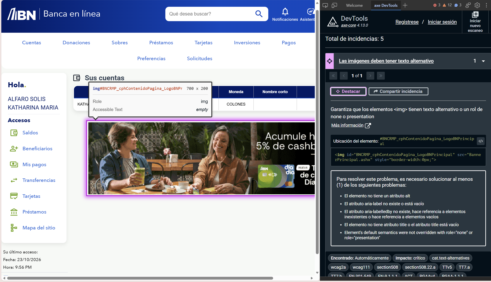

# 🐞 Reporte de Bug

## ID

BUG-002

## Título

Imagen principal sin texto alternativo accesible.

## Estado

- Nuevo

## Reportado por

Katharina Alfaro Solís

## Fecha de detección

2026-10-23

## Prioridad

- 🟡 Media

La ausencia de una alternativa textual puede impedir que las personas que utilizan lectores de pantalla accedan a la información o al propósito de la imagen. El impacto específico debe confirmarse revisando su contenido y función. Se puso como prioridad media debido a que no es una imagen que afecte la funcionalidad de la página, es informativa.

## Descripción

La herramienta axe identifica que la imagen con el ID `BNCRMP_cphContenidoPagina_LogoBNPrincipal` no tiene un atributo `alt` ni un nombre accesible proporcionado mediante `aria-label`, `aria-labelledby` o `title`. Tampoco se ha marcado como decorativa mediante un rol `none` o `presentation`.

Este hallazgo corresponde a la regla `image-alt` y al criterio 1.1.1 Contenido no textual, nivel A de WCAG 2.0, también aplicable en WCAG 2.1 y 2.2. Cumplir el nivel AA requiere cumplir también los criterios de nivel A.

Sin una alternativa adecuada, las personas que utilizan lectores de pantalla pueden no conocer la información o el propósito de la imagen. La forma exacta en que se anuncia depende del lector de pantalla y del navegador utilizados.

## Pasos para reproducir

1. Iniciar sesión con un usuario de pruebas autorizado.
2. Acceder a la página indicada en el entorno de pruebas y confirmar que contiene la imagen señalada.
3. Ejecutar un análisis de accesibilidad con axe.
4. Revisar el hallazgo de la regla `image-alt` asociado al selector `#BNCRMP_cphContenidoPagina_LogoBNPrincipal`.
5. Inspeccionar el elemento y comprobar que no tiene una alternativa textual ni una identificación explícita como imagen decorativa.

## Resultado esperado

- Si la imagen transmite información, debe contar con una alternativa textual que comunique su contenido o propósito.
- Si la imagen funciona como enlace o control, su alternativa debe comunicar la función o el destino.
- Si es exclusivamente decorativa, debe excluirse adecuadamente de la lectura asistida, preferiblemente mediante `alt=""` en el elemento ``, sin ocultar información significativa.

## Resultado obtenido

Axe reporta que la imagen no dispone de una alternativa textual accesible y no está marcada como decorativa.

| Propiedad | Valor reportado |
|---|---|
| Selector | `#BNCRMP_cphContenidoPagina_LogoBNPrincipal` |
| Recurso de imagen | `BannerPrincipal.ashx` |
| Atributo `alt` | Ausente |
| Atributo `aria-label` | Ausente |
| Atributo `aria-labelledby` | Ausente |
| Atributo `title` | Ausente |
| Rol `none` o `presentation` | Ausente |
| Regla | `image-alt` |
| Criterio afectado | WCAG 1.1.1 Contenido no textual, nivel A |

## Evidencia

- Elemento HTML reportado por axe:

```html

```

- Captura de pantalla: . Debe mostrar el elemento y el hallazgo de axe, ocultando datos personales o financieros.


## Entorno de pruebas

- Navegador: Microsoft Edge.
- Dispositivo: Escritorio.
- Sistema operativo: Windows 11.
- URL o versión del sistema: https://bncr.bnonline.fi.cr/BNCR.InternetBanking.Web/CuentasSOA/IBTxn.aspx
- Herramienta: axe; versión 4.139.0.

## Notas adicionales

- Confirmar el contenido y la función de la imagen antes de elegir la corrección. El ID y el nombre del recurso no bastan para determinar si es un logotipo, un banner informativo o una imagen decorativa.
- Para una imagen informativa, se recomienda agregar un atributo `alt` descriptivo y pertinente. No es necesario agregar todos los atributos enumerados por axe.
- No utilizar `alt=""`, `role="none"` o `role="presentation"` únicamente para eliminar el hallazgo si la imagen comunica información o cumple una función.
- Validar la corrección con un nuevo análisis de axe y una comprobación con lector de pantalla; la ausencia de un hallazgo automático no garantiza que el texto alternativo sea adecuado.
- Corregir este hallazgo no demuestra por sí solo la conformidad completa de la página con WCAG AA; únicamente aborda el problema identificado.
