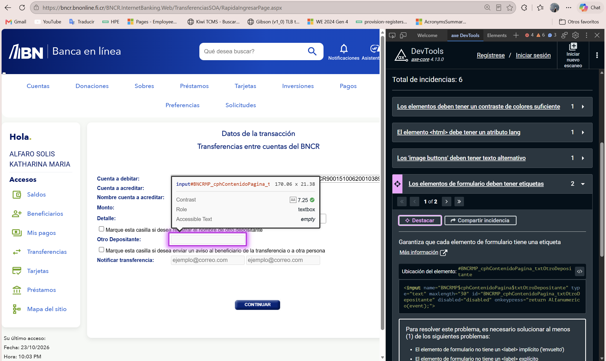

# 🐞 Reporte de Bug

## ID

BUG-003

## Título

Campo «Otro Depositante» sin etiqueta asociada ni nombre accesible.

## Estado

- Nuevo

## Reportado por

Katharina Alfaro Solís

## Fecha de detección

2026-10-23

## Prioridad

- 🟠 Alta.

La ausencia de un nombre accesible puede impedir que las personas que utilizan lectores de pantalla identifiquen el propósito del campo cuando esté habilitado.

## Descripción

La herramienta axe identifica que el campo de texto con el ID `BNCRMP_cphContenidoPagina_txtOtroDepositante` no tiene una etiqueta implícita o explícita asociada, ni un nombre accesible proporcionado mediante `aria-label`, `aria-labelledby` o `title`.

En la captura se observa el texto visible «Otro Depositante:» junto al campo; sin embargo, el hallazgo indica que ese texto no está asociado programáticamente al control. La información de inspección muestra el rol `textbox` y el texto accesible vacío.

Este hallazgo corresponde a la regla `label` y al criterio 4.1.2 Nombre, función, valor, nivel A de WCAG 2.0, también aplicable en WCAG 2.1 y 2.2. La falta de asociación programática entre el texto visible y el control también debe revisarse respecto al criterio 1.3.1 Información y relaciones, nivel A. Cumplir el nivel AA requiere cumplir también los criterios de nivel A.

El elemento reportado está deshabilitado mediante `disabled="disabled"`. Es necesario comprobar también su nombre accesible cuando se habilita para registrar otro depositante; estar deshabilitado no sustituye una etiqueta adecuada.

## Pasos para reproducir

1. Iniciar sesión con un usuario de pruebas autorizado.
2. Acceder a la página de transferencias entre cuentas del BNCR indicada en el entorno de pruebas.
3. Localizar el campo «Otro Depositante», situado debajo de la casilla para registrar el nombre de otro depositante.
4. Ejecutar un análisis de accesibilidad con axe.
5. Revisar el hallazgo de la regla `label` asociado al selector `#BNCRMP_cphContenidoPagina_txtOtroDepositante`.
6. Inspeccionar el elemento y comprobar la ausencia de una etiqueta asociada y de un nombre accesible.
7. Marcar la casilla para registrar otro depositante y verificar el etiquetado del campo en su estado habilitado, sin completar ni enviar una transferencia.

## Resultado esperado

- El campo debe tener una etiqueta visible y asociada programáticamente que comunique su propósito.
- Se recomienda asociar el texto «Otro Depositante:» mediante un elemento `<label>` cuyo atributo `for` coincida con el ID del campo.
- El nombre accesible debe incluir el texto de la etiqueta visible y mantenerse tanto en el estado deshabilitado como en el habilitado.
- El lector de pantalla debe poder identificar el propósito y el estado del control.

## Resultado obtenido

Axe reporta que el campo «Otro Depositante» no dispone de una etiqueta asociada ni de un nombre accesible, aunque existe un texto visible junto al control.

| Propiedad | Valor reportado |
|---|---|
| Selector | `#BNCRMP_cphContenidoPagina_txtOtroDepositante` |
| Tipo de elemento | `<input type="text">` |
| Texto visible cercano | Otro Depositante: |
| Etiqueta `<label>` implícita | Ausente, según el hallazgo de axe |
| Etiqueta `<label>` explícita | Ausente, según el hallazgo de axe |
| Atributo `aria-label` | Ausente |
| Atributo `aria-labelledby` | Ausente |
| Atributo `title` | Ausente |
| Atributo `placeholder` | Ausente |
| Estado | Deshabilitado (`disabled="disabled"`) |
| Longitud máxima | 30 caracteres |
| Rol mostrado en la inspección | `textbox` |
| Texto accesible mostrado en la inspección | Vacío |
| Regla | `label` |
| Criterio afectado | WCAG 4.1.2 Nombre, función, valor, nivel A |

## Evidencia

- Elemento HTML reportado por axe:

```html
<input name="BNCRMP$cphContenidoPagina$txtOtroDepositante" type="text" maxlength="30" id="BNCRMP_cphContenidoPagina_txtOtroDepositante" disabled="disabled" onkeypress="return Alfanumerico(event);">
```

- Captura de pantalla: .
- La captura muestra el campo resaltado y el hallazgo de axe. Contiene datos personales y bancarios visibles que deben ocultarse antes de compartir el reporte fuera del entorno autorizado.

## Entorno de pruebas

- Navegador: Microsoft Edge.
- Dispositivo: Escritorio.
- Sistema operativo: Windows 11.
- URL o versión del sistema: https://bncr.bnonline.fi.cr/BNCR.InternetBanking.Web/TransferenciasSOA/RapidaIngresarPage.aspx
- Herramienta: axe DevTools; motor axe-core 4.13.0, visible en la captura.

## Notas adicionales

- Referencia de la regla: [Garantiza que cada elemento de formulario tiene una etiqueta — Deque University](https://dequeuniversity.com/rules/axe/4.13/label?application=AxeChrome&lang=es).
- Axe enumera alternativas para resolver el hallazgo: etiqueta implícita, etiqueta explícita, `aria-label`, `aria-labelledby` válido y no vacío, o `title`. No es necesario agregar todos estos mecanismos; para este campo con texto visible, se recomienda una etiqueta `<label>` explícita.
- El diagnóstico también señala la ausencia de `placeholder` y que la semántica predeterminada no se ha sustituido por `role="none"` o `role="presentation"`. Estas observaciones no deben interpretarse como recomendaciones para sustituir una etiqueta visible o eliminar la semántica de un control funcional.
- Si se utiliza `aria-labelledby`, debe hacer referencia al ID de un elemento existente con texto pertinente y no vacío.
- Validar la corrección con un nuevo análisis de axe y una comprobación con lector de pantalla, tanto antes como después de habilitar el campo. La ausencia de un hallazgo automático no garantiza que la etiqueta sea adecuada.
- La captura muestra dos elementos afectados por la regla `label`; este reporte documenta únicamente el campo identificado por el selector proporcionado.
- Corregir este hallazgo no demuestra por sí solo la conformidad completa de la página con WCAG AA; únicamente aborda el problema identificado.