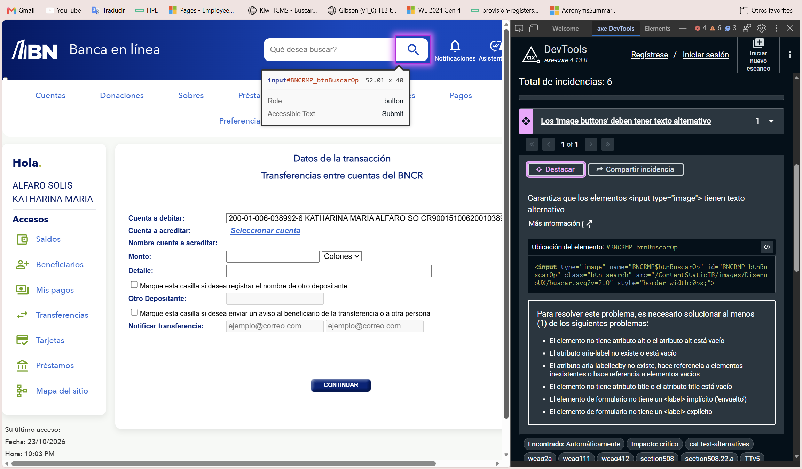

# 🐞 Reporte de Bug

## ID

BUG-004

## Título

Botón de búsqueda de tipo imagen sin texto alternativo que describa su función.

## Estado

- Nuevo

## Reportado por

Katharina Alfaro Solís

## Fecha de detección

2026-10-23

## Prioridad

- 🟠 Alta.

La falta de una alternativa textual descriptiva puede impedir que las personas que utilizan lectores de pantalla identifiquen la función de búsqueda. Axe clasifica el impacto del hallazgo como crítico; esta clasificación técnica no equivale automáticamente a la prioridad del proyecto.

## Descripción

La herramienta axe identifica que el botón con el ID `BNCRMP_btnBuscarOp`, implementado mediante un elemento `<input type="image">`, no tiene un atributo `alt` ni una alternativa proporcionada mediante `aria-label`, `aria-labelledby`, `title` o una etiqueta `<label>` asociada.

La captura muestra un icono de lupa junto al campo «Qué desea buscar?». La información de inspección presenta el rol `button` y el texto accesible genérico «Submit», que no describe la función específica de búsqueda. No debe confundirse este texto predeterminado con una alternativa textual adecuada proporcionada por la aplicación.

Este hallazgo corresponde a la regla `input-image-alt` y a los criterios 1.1.1 Contenido no textual y 4.1.2 Nombre, función, valor, ambos de nivel A de WCAG 2.0, también aplicables en WCAG 2.1 y 2.2. Cumplir el nivel AA requiere cumplir también los criterios de nivel A.

Sin una alternativa que comunique la acción del botón, una persona que utiliza un lector de pantalla podría no reconocer que el control ejecuta una búsqueda. El anuncio exacto depende de la combinación de navegador y tecnología de asistencia.

## Pasos para reproducir

1. Iniciar sesión con un usuario de pruebas autorizado.
2. Acceder a la página de transferencias entre cuentas del BNCR mostrada en la captura.
3. Localizar el botón con icono de lupa situado junto al campo de búsqueda en el encabezado.
4. Ejecutar un análisis de accesibilidad con axe.
5. Revisar el hallazgo de la regla `input-image-alt` asociado al selector `#BNCRMP_btnBuscarOp`.
6. Inspeccionar el elemento y comprobar la ausencia de `alt` y de los demás mecanismos de etiquetado señalados.
7. Comprobar con un lector de pantalla cómo se anuncia el botón, sin completar ni enviar una transferencia.

## Resultado esperado

- El botón debe disponer de una alternativa textual que describa su función, por ejemplo, «Buscar».
- Para el elemento `<input type="image">` existente, se recomienda incorporar `alt="Buscar"`.
- El lector de pantalla debe anunciar un nombre descriptivo y la función de botón, en lugar de depender de un texto genérico como «Submit».
- La corrección debe conservar el comportamiento de búsqueda y la operabilidad mediante teclado.

## Resultado obtenido

Axe reporta que el botón de tipo imagen no tiene texto alternativo adecuado. En la inspección de la captura aparece el texto accesible genérico «Submit», aunque visualmente se presenta un icono de búsqueda.

| Propiedad | Valor reportado |
|---|---|
| Selector | `#BNCRMP_btnBuscarOp` |
| Tipo de elemento | `<input type="image">` |
| Clase | `btn-search` |
| Recurso de imagen | `/ContentStaticIB/images/DisennoUX/buscar.svg?v=2.0` |
| Atributo `alt` | Ausente |
| Atributo `aria-label` | Ausente |
| Atributo `aria-labelledby` | Ausente |
| Atributo `title` | Ausente |
| Etiqueta `<label>` implícita | Ausente, según el hallazgo de axe |
| Etiqueta `<label>` explícita | Ausente, según el hallazgo de axe |
| Rol mostrado en la inspección | `button` |
| Texto accesible mostrado en la inspección | Submit |
| Regla | `input-image-alt` |
| Impacto indicado por axe | Crítico |
| Criterios afectados | WCAG 1.1.1 Contenido no textual y 4.1.2 Nombre, función, valor, nivel A |

## Evidencia

- Elemento HTML reportado por axe:

```html
<input type="image" name="BNCRMP$btnBuscarOp" id="BNCRMP_btnBuscarOp" class="btn-search" src="/ContentStaticIB/images/DisennoUX/buscar.svg?v=2.0" style="border-width:0px;">
```

- Captura de pantalla: .
- La captura muestra el botón de búsqueda y el detalle de la regla `input-image-alt`. Contiene datos personales y bancarios visibles que deben ocultarse antes de compartir el reporte fuera del entorno autorizado.

## Entorno de pruebas

- Navegador: Microsoft Edge.
- Dispositivo: Escritorio.
- Sistema operativo: Windows 11.
- Pantalla: Transferencias entre cuentas del BNCR.
- Herramienta: axe DevTools; motor axe-core 4.13.0, visible en la captura.

## Notas adicionales

- Referencia de la regla: [Garantiza que los elementos de tipo imagen tienen texto alternativo — Deque University](https://dequeuniversity.com/rules/axe/4.13/input-image-alt?application=AxeChrome&lang=es).
- Axe enumera alternativas para resolver el hallazgo: `alt`, `aria-label`, `aria-labelledby` válido y no vacío, `title`, una etiqueta implícita o una etiqueta explícita. No es necesario agregar todos estos mecanismos; se recomienda `alt="Buscar"` para el control existente.
- El texto alternativo debe describir la acción, no únicamente la apariencia de la imagen. «Buscar» comunica mejor la función que «Lupa» o el nombre del archivo SVG.
- No utilizar `alt=""`, `role="none"` o `role="presentation"` para ocultar un botón funcional a las tecnologías de asistencia.
- Si se utiliza `aria-labelledby`, debe hacer referencia a un elemento existente con texto pertinente y no vacío.
- Validar la corrección con un nuevo análisis de axe, navegación por teclado y una comprobación con lector de pantalla. Confirmar también que el botón continúa ejecutando la búsqueda prevista.
- Corregir este hallazgo no demuestra por sí solo la conformidad completa de la página con WCAG AA; únicamente aborda el problema identificado.