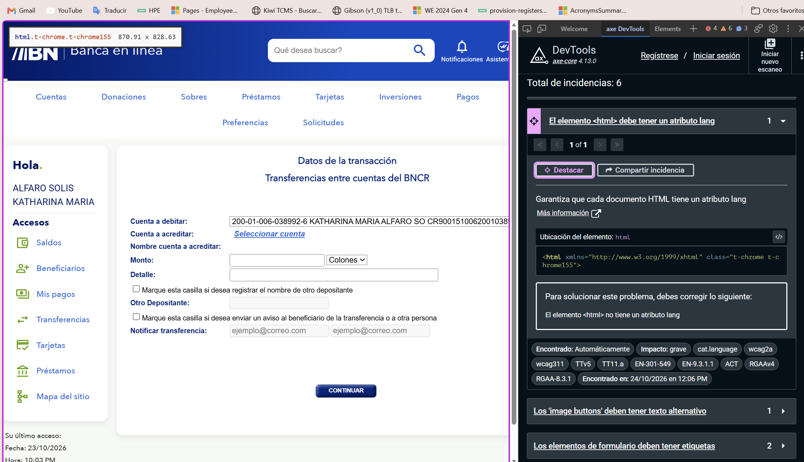

# 🐞 Reporte de Bug

## ID

BUG-005

## Título

Documento HTML sin declaración del idioma principal mediante el atributo `lang`.

## Estado

- Nuevo

## Reportado por

Katharina Alfaro Solís

## Fecha de detección

2026-10-24.

## Prioridad

- 🟡 Media (molesta, pero tiene solución temporal).

La ausencia del idioma principal puede afectar la pronunciación y la comprensión del contenido al utilizar lectores de pantalla. Axe clasifica el impacto del hallazgo como grave, sin embargo este bug va a ser considerado prioridad media.

## Descripción

La herramienta axe identifica que el elemento raíz `<html>` del documento no tiene el atributo `lang`. Aunque la interfaz mostrada está en español, el idioma principal no está declarado programáticamente en ese elemento.

Este hallazgo corresponde a la regla `html-has-lang` y al criterio 3.1.1 Idioma de la página, nivel A de WCAG 2.0, también aplicable en WCAG 2.1 y 2.2. Cumplir el nivel AA requiere cumplir también los criterios de nivel A.

Sin una declaración del idioma, los lectores de pantalla pueden utilizar una voz o reglas de pronunciación que no correspondan al contenido, dependiendo de su configuración. El atributo `xmlns` presente en el elemento declara un espacio de nombres y no sustituye el atributo `lang`.

## Pasos para reproducir

1. Iniciar sesión con un usuario de pruebas autorizado.
2. Acceder a la página de transferencias entre cuentas del BNCR mostrada en la captura.
3. Ejecutar un análisis de accesibilidad con axe.
4. Revisar el hallazgo de la regla `html-has-lang` asociado al selector `html`.
5. Inspeccionar el elemento raíz del documento y comprobar que no tiene el atributo `lang`.
6. Verificar con un lector de pantalla el idioma utilizado para leer el contenido, sin completar ni enviar una transferencia.

## Resultado esperado

- El elemento `<html>` debe declarar el idioma principal del documento mediante un atributo `lang` válido y no vacío.
- Para el contenido en español observado, se recomienda `lang="es"`; puede utilizarse `lang="es-CR"` si corresponde declarar específicamente la variante de español de Costa Rica.
- Las tecnologías de asistencia deben poder determinar programáticamente el idioma principal y aplicar las reglas de pronunciación correspondientes.

## Resultado obtenido

Axe reporta que el elemento `<html>` no tiene el atributo `lang`, por lo que el idioma principal de la página no está declarado mediante este mecanismo.

| Propiedad | Valor reportado |
|---|---|
| Selector | `html` |
| Elemento | `<html>` |
| Atributo `lang` | Ausente |
| Atributo `xmlns` | `http://www.w3.org/1999/xhtml` |
| Clase | `t-chrome t-chrome155` |
| Idioma visible del contenido | Español |
| Regla | `html-has-lang` |
| Detección | Automática |
| Impacto indicado por axe | Grave |
| Categoría | `cat.language` |
| Criterio afectado | WCAG 3.1.1 Idioma de la página, nivel A |
| Fecha y hora del hallazgo | 24/10/2026, 12:06 PM |
| Etiquetas adicionales reportadas | `wcag2a`, `wcag311`, `TTv5`, `TT11.a`, `EN-301-549`, `EN-9.3.1.1`, `ACT`, `RGAAv4`, `RGAA-8.3.1` |

## Evidencia

- Elemento HTML reportado por axe:

```html
<html xmlns="http://www.w3.org/1999/xhtml" class="t-chrome t-chrome155">
```

- Captura de pantalla: .
- La captura muestra el elemento raíz resaltado, la regla `html-has-lang`, el impacto grave y la fecha del hallazgo. Contiene datos personales y bancarios visibles que deben ocultarse antes de compartir el reporte fuera del entorno autorizado.

## Entorno de pruebas

- Navegador: Microsoft Edge.
- Dispositivo: Escritorio.
- Sistema operativo: Windows 11.
- Pantalla: Transferencias entre cuentas del BNCR.
- Herramienta: axe DevTools; motor axe-core 4.13.0, visible en la captura.

## Notas adicionales

- Referencia de la regla: [Garantiza que cada documento HTML tiene un atributo lang — Deque University](https://dequeuniversity.com/rules/axe/4.13/html-has-lang?application=AxeChrome&lang=es).
- Se recomienda agregar `lang="es"` al elemento raíz, conservando los atributos existentes:

```html
<html xmlns="http://www.w3.org/1999/xhtml" class="t-chrome t-chrome155" lang="es">
```

- Confirmar el idioma principal real antes de aplicar la corrección. El valor debe ser una etiqueta de idioma válida conforme a BCP 47 y corresponder al contenido de la página.
- Si el elemento raíz se genera desde una plantilla compartida, revisar allí la declaración del idioma y comprobar las páginas que la utilizan. Esta evidencia no demuestra que todas las páginas del sistema estén afectadas.
- Si existen fragmentos en otro idioma, evaluar por separado su marcado de idioma; declarar el idioma principal no resuelve automáticamente los cambios de idioma dentro del contenido.
- Validar la corrección con un nuevo análisis de axe y una comprobación con lector de pantalla. Confirmar no solo la presencia del atributo, sino también que su valor es válido y corresponde al idioma del documento.
- Las etiquetas normativas de axe se registran como metadatos del hallazgo; no representan una evaluación completa de conformidad con cada estándar mencionado.
- Corregir este hallazgo no demuestra por sí solo la conformidad completa de la página con WCAG AA; únicamente aborda el problema identificado.