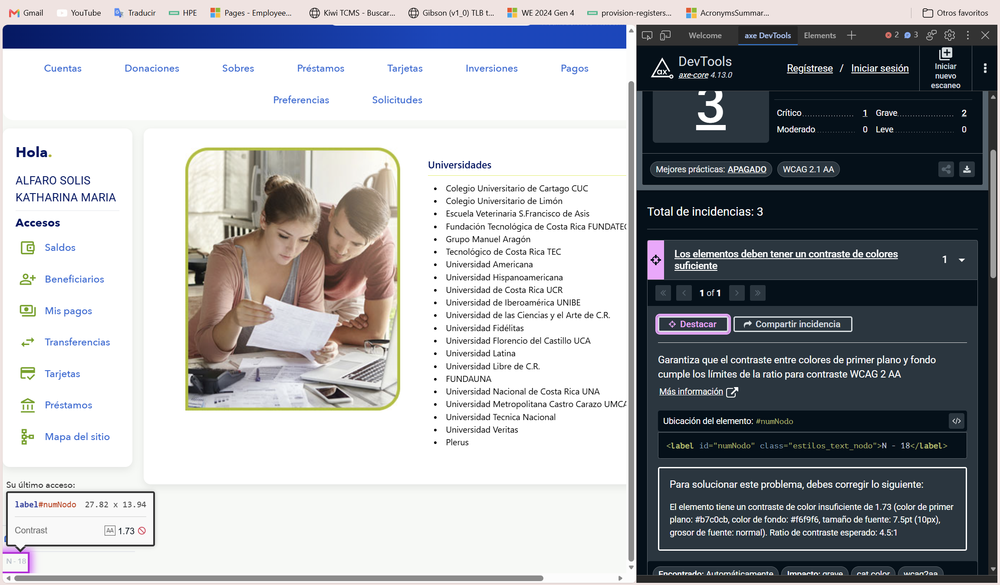

# 🐞 Reporte de Bug

## ID

BUG-006

## Título

Texto «N - 18» con contraste insuficiente respecto al fondo.

## Estado

- Nuevo

## Reportado por

Katharina Alfaro Solís

## Fecha de detección

2026-10-24.

## Prioridad

- ⚪ Baja

El bajo contraste puede dificultar la lectura del texto, especialmente a personas con baja visión. Axe clasifica el impacto del hallazgo como grave; esta clasificación técnica no equivale automáticamente a la prioridad del proyecto. Sin embargo, se calificó como prioridad baja ya que el texto no es relevante.

## Descripción

La herramienta axe identifica que el texto «N - 18», contenido en el elemento con ID `numNodo` y clase `estilos_text_nodo`, tiene una relación de contraste de 1.73:1 entre el color de primer plano `#b7c0cb` y el fondo `#f6f9f6`.

El texto tiene un tamaño de 7.5 pt (10 px) y grosor normal, por lo que no se considera texto grande. La relación mínima requerida es de 4.5:1, superior al valor reportado.

Este hallazgo corresponde a la regla `color-contrast` y al criterio 1.4.3 Contraste (mínimo), nivel AA de WCAG 2.0, también aplicable en WCAG 2.1 y 2.2.

La captura muestra el elemento en la zona inferior izquierda de la página. Su significado y función deben confirmarse con el banco, pero no parece ser información relevante.

## Pasos para reproducir

1. Iniciar sesión con un usuario de pruebas autorizado.
2. Acceder a la página que muestra la sección «Universidades», en Pagos.
3. Desplazarse hasta la zona inferior izquierda y localizar el texto «N - 18».
4. Ejecutar un análisis de accesibilidad con axe.
5. Revisar el hallazgo de la regla `color-contrast` asociado al selector `#numNodo`.
6. Inspeccionar los colores y la tipografía del elemento: primer plano `#b7c0cb`, fondo `#f6f9f6`, tamaño de 10 px y grosor normal.
7. Comprobar la relación de contraste reportada de 1.73:1 frente al mínimo requerido de 4.5:1.

## Resultado esperado

- El texto de tamaño normal debe tener una relación de contraste de al menos 4.5:1 con su fondo.
- Deben ajustarse el color del texto, el color de fondo o ambos, conservando el contenido y su legibilidad.
- La combinación final debe medirse sobre el fondo real del elemento y alcanzar el mínimo requerido sin depender del redondeo del resultado.
- O si es un texto que el usuario deba ver debería ser removido.

## Resultado obtenido

Axe reporta una relación de contraste de 1.73:1 para el texto «N - 18», inferior al mínimo de 4.5:1 requerido para su tamaño y grosor.

| Propiedad | Valor reportado |
|---|---|
| Selector | `#numNodo` |
| Elemento | `<label>` |
| Texto | N - 18 |
| Clase | `estilos_text_nodo` |
| Color de primer plano | `#b7c0cb` |
| Color de fondo | `#f6f9f6` |
| Tamaño de fuente | 7.5 pt (10 px) |
| Grosor de fuente | Normal |
| Relación de contraste obtenida | 1.73:1 |
| Relación de contraste mínima requerida | 4.5:1 |
| Regla | `color-contrast` |
| Detección | Automática |
| Impacto indicado por axe | Grave |
| Categoría | `cat.color` |
| Criterio afectado | WCAG 1.4.3 Contraste (mínimo), nivel AA |
| Fecha y hora del hallazgo | 24/10/2026, 12:23 PM |
| Etiquetas adicionales reportadas | `wcag2aa`, `wcag143`, `TTv5`, `TT13.c`, `EN-301-549`, `EN-9.1.4.3`, `ACT`, `RGAAv4`, `RGAA-3.2.1` |

## Evidencia

- Elemento HTML reportado por axe:

```html
<label id="numNodo" class="estilos_text_nodo">N - 18</label>
```

- Captura de pantalla: .
- La captura muestra el elemento resaltado y los colores, la tipografía y la relación de contraste reportados. Contiene datos personales visibles que deben ocultarse antes de compartir el reporte fuera del entorno autorizado.

## Entorno de pruebas

- Navegador: Microsoft Edge.
- Dispositivo: Escritorio.
- Sistema operativo: Windows 11.
- Pantalla: Página con la sección «Universidades».
- Herramienta: axe DevTools; motor axe-core 4.13.0.
- Configuración de análisis visible: WCAG 2.1 AA; mejores prácticas desactivadas.

## Notas adicionales

- Referencia de la regla: [Contraste entre colores de primer plano y fondo — Deque University](https://dequeuniversity.com/rules/axe/4.13/color-contrast?application=AxeChrome&lang=es).
- Se recomienda revisar el estilo que determina el color efectivo del elemento y seleccionar una combinación con contraste suficiente. Si se modifica la clase compartida `estilos_text_nodo`, comprobar también los demás elementos que la utilicen y sus respectivos fondos.
- No basta con elegir un color visualmente más oscuro: debe medirse la combinación final y verificar que alcanza al menos 4.5:1 para el texto actual.
- El umbral de 3:1 se aplica a texto grande, a partir de 18 pt (24 px) con grosor normal o de 14 pt (aproximadamente 18.67 px) en negrita. No corresponde al texto reportado de 7.5 pt y grosor normal.
- El tamaño de 10 px se registra como contexto del hallazgo; no se afirma que ese tamaño por sí solo constituya una infracción del criterio 1.4.3.
- Confirmar el propósito del texto antes de considerar una excepción del criterio. No ocultar ni eliminar información funcional únicamente para hacer desaparecer el hallazgo.
- Validar la corrección con un nuevo análisis de axe, una medición de contraste y una revisión visual en los estados y fondos donde aparezca el elemento, conservando su contenido y función.
- Las etiquetas normativas de axe se registran como metadatos del hallazgo; no representan una evaluación completa de conformidad con cada estándar mencionado.
- Corregir este hallazgo no demuestra por sí solo la conformidad completa de la página con WCAG AA; únicamente aborda el problema identificado.