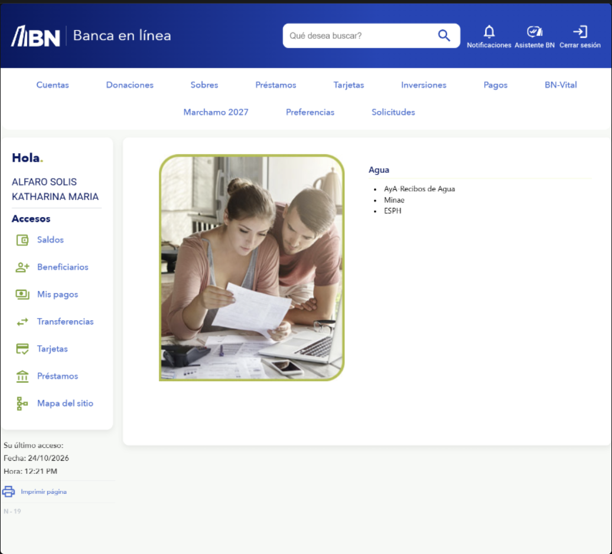
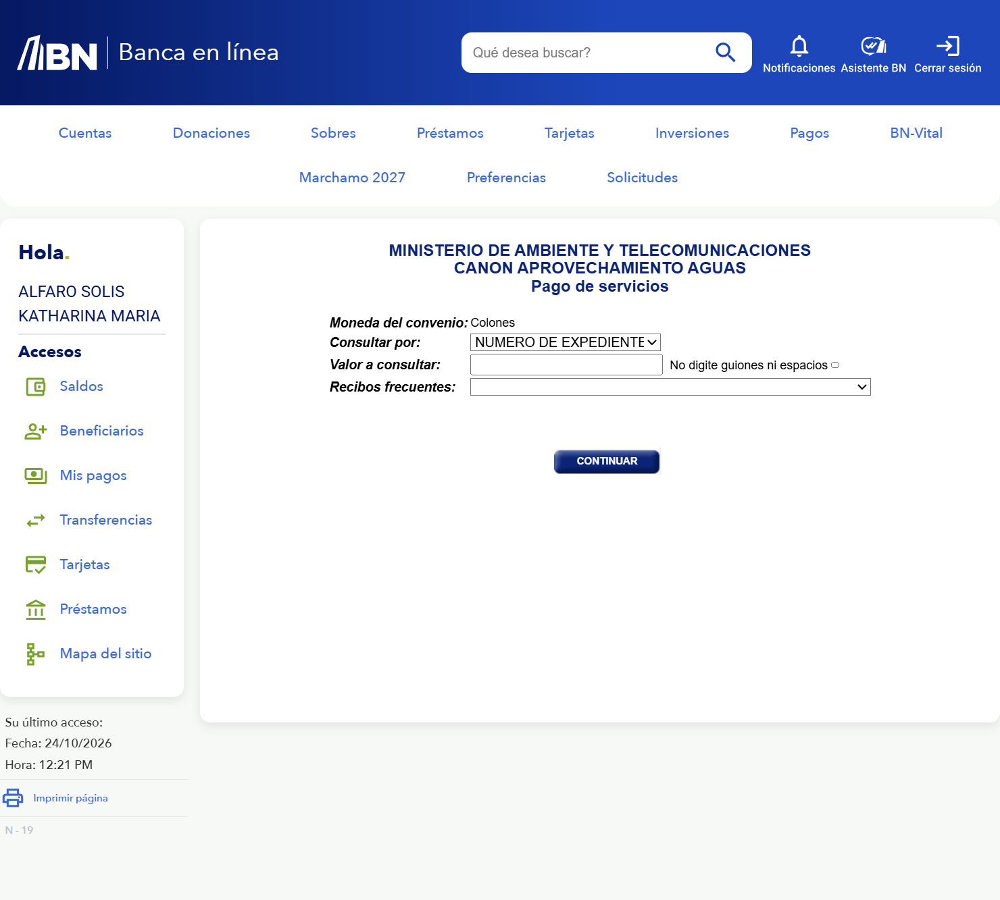
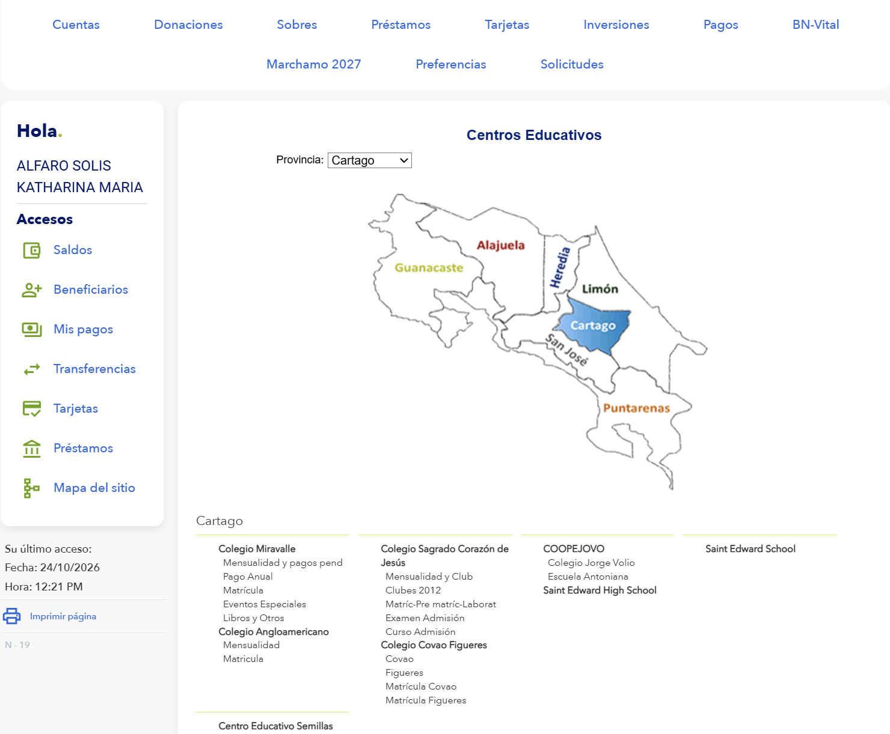

# Tarea 4: Propuestas de mejoras de UI y UX para Pagos

## Base del análisis

Se analizan los casos de prueba de [Pagos de la Tarea 2](../Tarea2/Pagos.md), la [captura del menú de pagos](../Tarea2/Pagos-Variedad.png) y las capturas adicionales compartidas de la selección de proveedores de agua, del formulario de pago y de Centros Educativos.

El alcance incluye encontrar un servicio, seleccionar su proveedor, consultar un recibo y localizar un centro educativo y su concepto de pago. En la Tarea 2 se logró consultar un cobro universitario, pero no se completó un pago de servicio público. La nueva captura de Centros Educativos permite analizar su catálogo, no comprobar la consulta ni la ejecución de un pago en esa sección.

## Mejora 1: Facilitar la búsqueda del servicio y la selección del proveedor

**Hallazgo y evidencia**

El menú presenta numerosas categorías y opciones distribuidas en cuatro columnas. Después de elegir Agua, aparece otra pantalla con una imagen decorativa grande y una lista pequeña de proveedores: AyA, Minae y ESPH. La Tarea 2 confirma que la selección del servicio conduce a otra página con sus proveedores.

**Propuesta de UI y UX**

- Incorporar un buscador específico de servicios y proveedores con resultados que indiquen su categoría; por ejemplo, buscar “ESPH” y encontrarlo dentro de Agua.
- Mantener las categorías, pero presentar los proveedores como opciones claramente seleccionables, con nombre completo y sigla. Reducir el espacio de la imagen decorativa para dar prioridad a la tarea.
- Mostrar la ruta “Pagos > Agua > Proveedor” y una acción “Cambiar proveedor”. Adaptar el catálogo a una columna en pantallas pequeñas y permitir recorrer las opciones con teclado y foco visible.

**Beneficio esperado**

Reducir el esfuerzo de explorar el menú y evitar que la persona usuaria pierda la ubicación al pasar de una categoría a un proveedor.

**Criterios de evaluación**

- Una búsqueda por nombre o sigla muestra el proveedor y su categoría, o un mensaje explícito si no hay coincidencias.
- Desde la pantalla de proveedores se puede llegar al formulario con una sola selección.
- La ruta refleja el proveedor elegido y permite regresar a Agua sin reiniciar la búsqueda.

## Mejora 2: Hacer el formulario de consulta más claro y prevenir errores

**Hallazgo y evidencia**

En la captura del pago se muestran las etiquetas “Consultar por”, “Valor a consultar” y “Recibos frecuentes”. La indicación “No digite guiones ni espacios” aparece junto al campo, pero no se ve un ejemplo del identificador solicitado. El botón “Continuar” es pequeño en relación con el espacio disponible.

**Propuesta de UI y UX**

- Cambiar “Valor a consultar” por una etiqueta que corresponda al criterio seleccionado, como “Número de expediente”. Mostrar una ayuda sobre dónde encontrarlo en el recibo y un ejemplo ficticio que respete el formato real del proveedor.
- Validar el identificador según el convenio y mostrar errores junto al campo, indicando cómo corregirlos sin borrar lo digitado. Asociar las etiquetas y ayudas a sus controles para lectores de pantalla.
- Usar una acción principal “Consultar recibo”, con un área de interacción de al menos 44 × 44 píxeles. Explicar “Recibos frecuentes” como “Seleccionar un recibo guardado” y mostrar “No tienes recibos guardados” cuando corresponda.

**Beneficio esperado**

Disminuir la ambigüedad y los intentos de consulta con datos incorrectos, especialmente para quienes utilizan un proveedor por primera vez.

**Criterios de evaluación**

- Al cambiar el criterio de consulta, la etiqueta y la ayuda corresponden al identificador requerido.
- Un identificador vacío o con formato inválido genera un mensaje específico y conserva la entrada para corregirla.
- El formulario se puede completar con teclado y sus campos tienen etiquetas accesibles.

## Mejora 3: Facilitar la selección del centro educativo y del concepto de pago

**Hallazgo y evidencia**

La captura de Centros Educativos muestra un selector de provincia con Cartago seleccionado, un mapa grande de Costa Rica y, debajo, los centros y sus conceptos de pago distribuidos en columnas con texto pequeño. Algunas opciones aparecen abreviadas, como “Mensualidad y pagos pend”, y se mezclan nombres de instituciones, sedes y conceptos como matrícula o mensualidad. El mapa ocupa gran parte del espacio antes del listado, por lo que las opciones de pago quedan relegadas a la parte inferior.

**Propuesta de UI y UX**

- Dar prioridad al listado de centros y añadir un buscador por nombre, manteniendo el filtro de provincia. Reducir el mapa o permitir contraerlo como apoyo visual, sin exigir su uso para encontrar una institución.
- Organizar cada centro en una tarjeta o grupo con su nombre completo como encabezado, sus sedes identificadas cuando corresponda y sus conceptos de pago debajo. Usar etiquetas completas, texto legible y opciones seleccionables con un área de interacción de al menos 44 × 44 píxeles; en pantallas pequeñas, mostrar los grupos en una columna.
- Mostrar la ruta “Pagos > Educación > Centros Educativos” y, al seleccionar una opción, identificar claramente la institución, la sede si aplica y el concepto elegido. Permitir volver al listado conservando la provincia y la búsqueda, y mostrar un mensaje explícito cuando no existan centros coincidentes.

**Beneficio esperado**

Reducir el esfuerzo de localizar una institución y evitar confusiones entre centros, sedes y conceptos de pago, especialmente cuando una institución ofrece varias opciones.

**Criterios de evaluación**

- La búsqueda por nombre muestra únicamente centros coincidentes dentro de la provincia seleccionada, o un mensaje que permita modificar la búsqueda o el filtro.
- Cada concepto se asocia visualmente con su institución y su sede cuando corresponda, sin etiquetas truncadas; puede seleccionarse con teclado y foco visible.
- Al abrir una opción se muestran el centro y el concepto elegidos; al regresar, se mantienen la provincia y la búsqueda. A un ancho de 360 píxeles, el listado se puede utilizar sin desplazamiento horizontal de la página.
