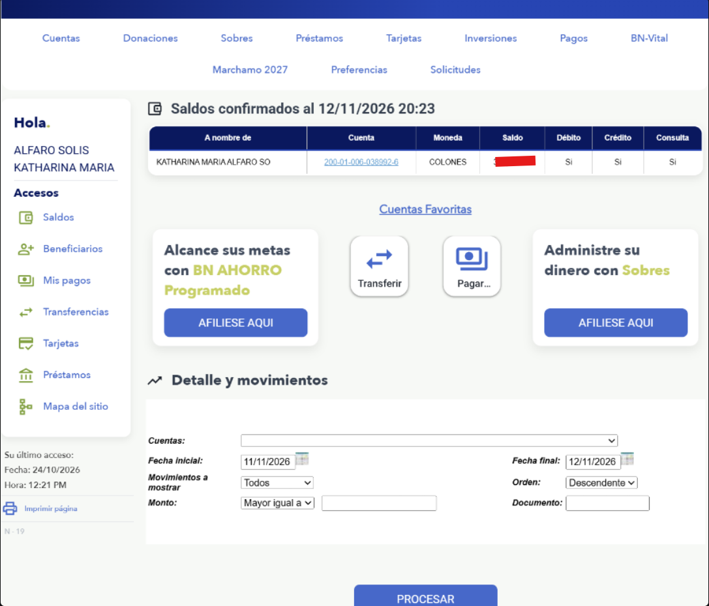

# Tarea 4: Propuestas de mejoras de UI y UX para Saldos y movimientos

## Base del análisis

Se utilizan los casos de prueba de [Consulta de saldos y movimientos de la Tarea 2](../Tarea2/Consulta-Saldos-Movimientos.md) y la siguiente captura de inicio.

Las pruebas documentan consultas satisfactorias de saldos y filtros por fechas y montos. Las oportunidades de mejora se centran en la organización visual, la facilidad de consulta y la explicación de los resultados; no implican que los saldos observados fueran incorrectos.

## Mejora 1: Priorizar el saldo y los movimientos sobre el contenido promocional

**Hallazgo y evidencia**

La observación de CT-005 señala que la página reúne saldos, ahorro programado, Sobres, transferencias y pagos, generando mucha información en un mismo lugar. En la captura, los bloques promocionales y las acciones rápidas se ubican entre la tabla de saldos y “Detalle y movimientos”.

**Propuesta de UI y UX**

- Organizar la pantalla en este orden: resumen de cuentas, consulta de movimientos y acciones secundarias. Mover las promociones a un bloque posterior o contraíble.
- Destacar el importe y su moneda con tipografía legible y alineación consistente. Mantener visible la fecha y hora de confirmación.
- Mantener “Transferir” y “Pagar” como accesos secundarios cercanos a la cuenta seleccionada, sin interrumpir la lectura de sus movimientos. En pantallas pequeñas, presentar el resumen por cuenta sin comprimir el importe en una tabla ilegible.

**Beneficio esperado**

Facilitar que la persona usuaria identifique cuánto dinero refleja su cuenta y encuentre el historial sin distracciones ajenas a la consulta.

**Criterios de evaluación**

- El resumen y la consulta de movimientos aparecen consecutivamente, sin promociones intermedias.
- Cada saldo se puede asociar claramente con una cuenta, una moneda y una fecha de actualización.
- A un ancho de 360 píxeles, el importe y las acciones principales son legibles sin desplazamiento horizontal de la página.

## Mejora 2: Simplificar los filtros de movimientos y hacer explícita la acción

**Hallazgo y evidencia**

Los casos CT-006, CT-007 y CT-008 requieren elegir cuenta, fechas y, en algunos casos, una condición de monto. La captura muestra estos controles repartidos en dos columnas, junto a “Orden” y “Documento”, con un botón genérico “PROCESAR” separado del formulario.

**Propuesta de UI y UX**

- Agrupar los controles principales “Cuenta” y “Período”, con accesos como “Últimos 7 días” y “Últimos 30 días”, manteniendo la selección manual de fechas.
- Colocar monto, documento y orden en “Filtros avanzados”. Expresar las condiciones de monto como “Mayor o igual que”, “Menor o igual que” e “Igual a”, mostrando la moneda correspondiente a la cuenta.
- Cambiar “PROCESAR” por “Consultar movimientos” y ubicarlo al final del grupo de filtros. Validar fechas y montos con mensajes junto al control y ofrecer “Restablecer filtros” sin cambiar inesperadamente la cuenta seleccionada.

**Beneficio esperado**

Reducir la carga visual para consultas comunes sin eliminar los filtros que ya funcionaron en la Tarea 2.

**Criterios de evaluación**

- Una consulta habitual se puede configurar con cuenta y período sin abrir filtros avanzados.
- Una fecha inicial posterior a la final o un monto no válido impide la consulta y explica la corrección necesaria.
- Las consultas por “Mayor o igual que” e “Igual a” siguen devolviendo resultados coherentes con la condición y el período elegidos.

## Mejora 3: Explicar los resultados vacíos, la carga y los errores de consulta

**Hallazgo y evidencia**

En CT-006 se indica que, cuando no hay transferencias en el rango seleccionado, se muestra una tabla sin valores. Esto no ayuda a distinguir entre una consulta válida sin movimientos y un problema de carga. La captura compartida corresponde a los filtros, por lo que no permite comprobar los indicadores de carga o error existentes.

**Propuesta de UI y UX**

- Sustituir la tabla vacía por “No se encontraron movimientos con los filtros seleccionados”, acompañado del período y de acciones para ampliar las fechas o quitar el filtro de monto.
- Durante la consulta, mostrar “Cargando movimientos…” y evitar envíos repetidos. Si se mantienen resultados anteriores en pantalla, identificarlos como anteriores hasta completar la nueva consulta.
- Mostrar errores de consulta de forma diferenciada, conservando los filtros y ofreciendo “Volver a consultar”. En un resultado exitoso, incluir la cantidad de movimientos y un resumen de los filtros aplicados; anunciar los cambios de estado a lectores de pantalla.

**Beneficio esperado**

Evitar que una ausencia de resultados se interprete como un fallo o como evidencia de que no existen movimientos fuera del rango consultado.

**Criterios de evaluación**

- Una consulta válida sin movimientos muestra un mensaje contextual y una acción para modificar los filtros.
- Un fallo de consulta se presenta como error, nunca como una tabla vacía ni como saldo cero.
- Al finalizar la consulta, los resultados corresponden a la cuenta y los filtros indicados; los estados de carga, éxito y error son perceptibles sin depender solo del color.
